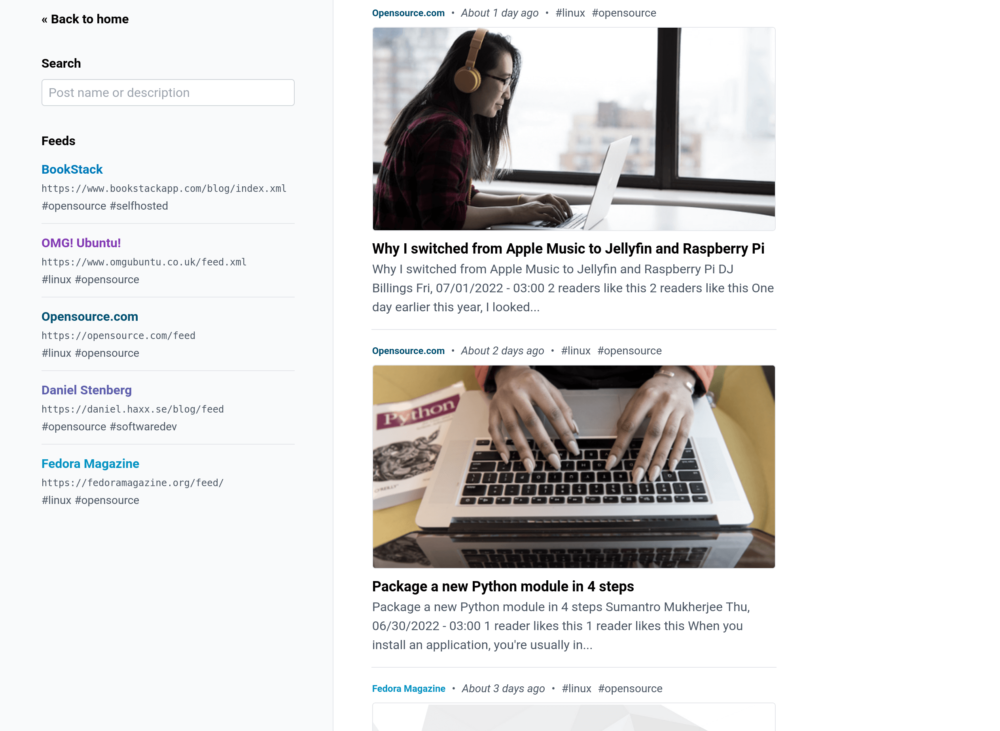
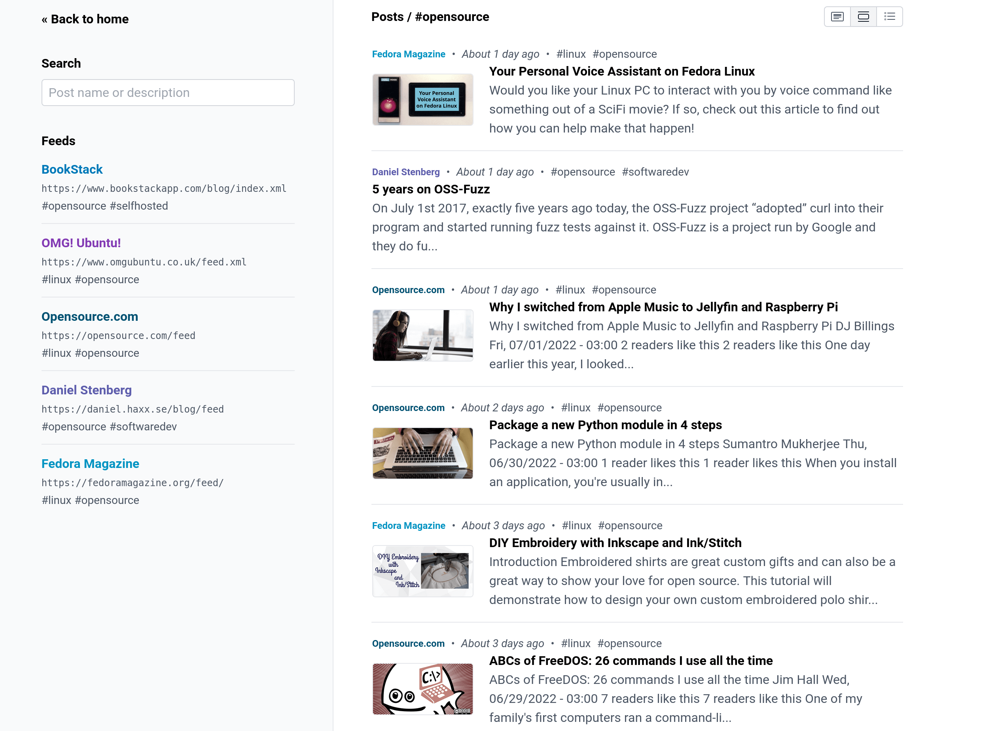
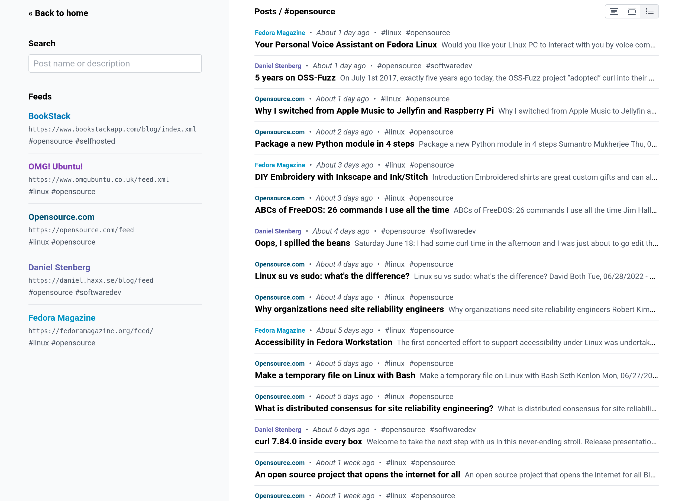
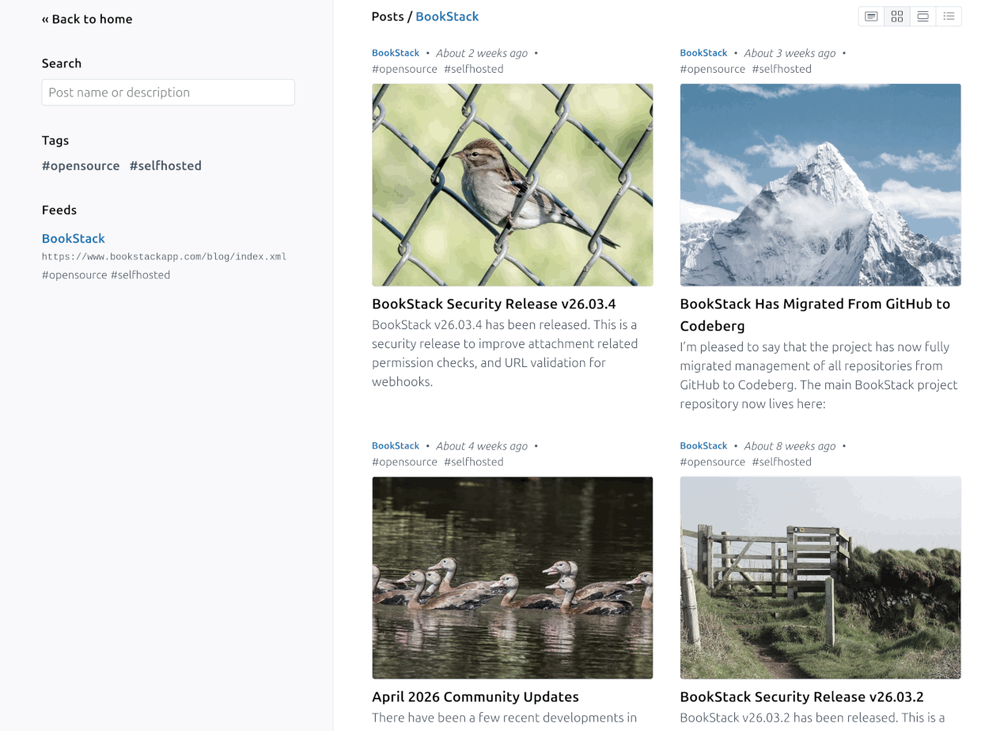
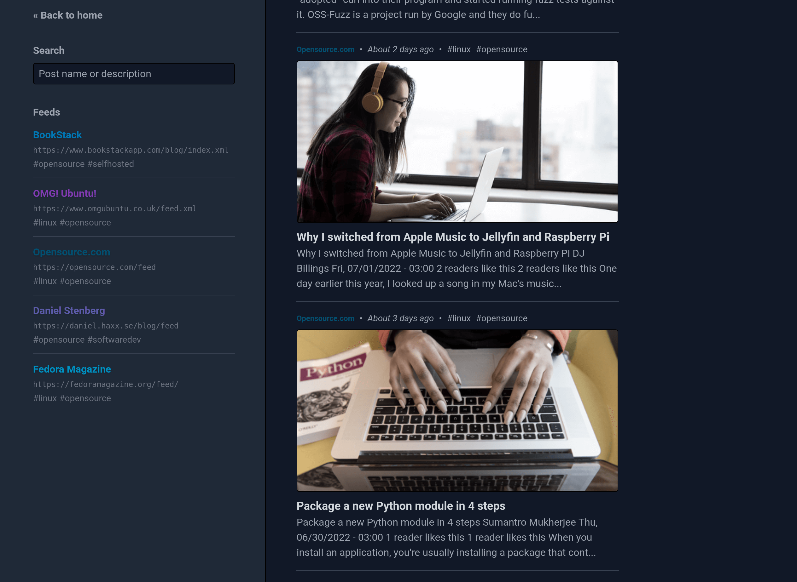
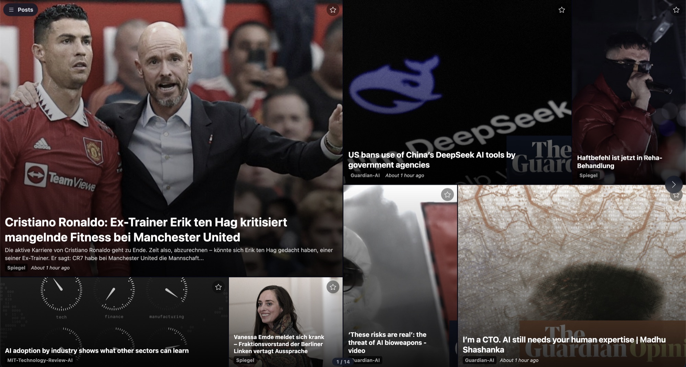

# rss-feed

[](https://github.com/smichard/rss-reader/actions/workflows/action.yml)
[](https://quay.io/repository/michard/rss-feed)

A simple, opinionated, web application which aggregates and displays RSS feeds in a clean social-feed-like UI.

## About this Fork

This project is a fork of [danb/rss](https://codeberg.org/danb/rss). On top of the original, it adds:

- **Menu selector pinned to the top right corner.** The menu stays in place at the top right instead of moving with the page.
- **Configurable theme.** Set the UI theme with the `APP_THEME` environment variable. It accepts `system`, `dark` or `light` (see [App Configuration](#app-configuration)).
- **Configurable dark background.** Set the background colour of the dark theme to any hex colour with `APP_DARK_BACKGROUND`, for example pure black for an OLED screen. The sidebar, hovered posts, buttons and flip view use matching lighter or darker shades of it (see [App Configuration](#app-configuration)).
- **Flip view.** An extra layout in the style of a digital newspaper that you can flip through page by page.
- **Flip view auto-advance.** Flip view can turn its pages on its own, for a wall screen or kiosk PC (see [Kiosk / Information Display](#kiosk--information-display)).
- **Feed favicons.** Each feed's website icon is shown on posts without a thumbnail in flip and grid view. The site can be set per feed with `site=` (see [Feed Configuration](#feed-configuration)).
- **Failing feed marker.** Feeds whose last fetch failed get a red dot in the feed list, with the reason on hover.
- **Cleaner aggregator titles.** For Google News and similar feeds, the publisher is removed from the title and shown as "via …" instead.
- **Duplicate stories collapsed.** The same story from several feeds is shown once, listing all its feeds.
- **Starred posts.** Posts can be starred and found again under "Starred". Stars are stored on the server, so every device sees the same list (see [Starred Posts](#starred-posts)).
- **Starred posts RSS feed.** The starred posts are published as an RSS feed at `/favorites`, including thumbnails.
- **Time filter.** Listings can be limited to the last 24 hours, 7 days or 30 days.

## Features

The following features are built into the application:

- Supports RSS and ATOM formats.
- Regular auto-fetching of RSS feeds.
  - Every hour by default, configurable down to 5 mins. 
- Custom feed names and colors.
- Feed-based tags for categorization.
- Ability to hide feed posts by default.
- 5 different post layout modes (card, grid, list, compact, flip).
- Fetching of page open-graph images.
- Feeds managed via a single plaintext file.
- System-based dark/light theme.
- Post title/description search.
- Feed website favicons on posts without a thumbnail (flip and grid view).
- Red dot next to feeds whose last fetch failed, with the reason on hover.
- Duplicate stories across feeds shown once, with all their feed names.
- Publisher suffixes removed from Google News titles and shown as "via <publisher>".
- Time filter (last 24 hours, 7 days or 30 days), combinable with search.
- Flip view auto-advance for kiosk displays (see [Kiosk / Information Display](#kiosk--information-display)).
- Starred / read-later posts, stored on the server and shared by all devices. They survive old posts being pruned.
- RSS feed of the starred posts at `/favorites` (see [Starred Posts RSS Feed](#starred-posts-rss-feed)).
- Ready-to-use docker image.
- Mobile screen compatible.
- Built-in support to prune old post data.

## Limitations

The below possibly expected features are missing from this application.

- No import of full post/article content.
- No feed management via the UI.
- No user system or user management system.
- No authentication or authorization built-in.
- No customization, extension or plugin system.
- No organisation upon simple feed-level tagging.
- Error handling is limited. Failing feeds are marked in the feed list, but other issues may not be reported clearly.

Upon the above, it's quite likely you'll come across issues. This project was created to meet a personal need while learning some new technologies. Much of the logic is custom written instead of using battle-tested libraries. 

## Screenshots

<table>
    <tbody>
        <tr>
            <td width="50%">
                <strong>Card View</strong>
                
            </td>
            <td width="50%">
                <strong>List View</strong>
                
            </td>
        </tr>
        <tr>
            <td width="50%">
                <strong>Compact View</strong>
                
            </td>
            <td width="50%">
                <strong>Grid View</strong>
                
            </td>
        </tr>
        <tr>
            <td width="50%">
                <strong>Dark Mode</strong>
                
            </td>
            <td width="50%">
                <strong>Flip View</strong>
                
            </td>
        </tr>
    </tbody>
</table>


## Docker Usage

A pre-built docker image is available to run the application. 
Storage data is confined to a single `/app/storage` directory for easy volume mounting.
Port 80 is exposed by default for application access. This application does not support HTTPS, for that you should instead use a proxy layer such as nginx.

#### Docker Run Command Example

In the below command, the application will be accessible at http://localhost:8080 on the host and the files would be stored in a `/home/barry/rss` directory. In this example, feeds would be configured in a `/home/barry/rss/feeds.txt` file.

```shell
docker run -d \
    --restart unless-stopped \
    -p 8080:80 \
    -v /home/barry/rss:/app/storage \
    quay.io/michard/rss-feed:latest
```

#### Docker Compose Example

In the below `docker-compose.yml` example, the application will be accessible at http://localhost:8080 on the host and the files would be stored in a `./rss-files` directory relative to the docker-compose.yml file. In this example, feeds would be configured in a `./rss-files/feeds.txt` file.

```yml
---
version: "2"
services:
    rss:
        image: quay.io/michard/rss-feed:latest
        container_name: rss
        environment:
            - APP_NAME=RSS
        volumes:
            - ./rss-files:/app/storage
        ports:
            - "8080:80"
        restart: unless-stopped
```


### Building the Docker Image

If you'd like to build the image from scratch, instead of using the pre-built image, you can do so like this:

```shell
docker build -f docker/Dockerfile .
```

## Feed Configuration

Feed configuration is handled by a plaintext file on the host system.
By default, using our docker image, this configuration would be located in a `feeds.txt` file within the path you mounted to `/app/storage`.

The format of this file can be seen below:

```txt
https://feed.url.com/feed.xml feed-name #tag-a #tag-b
https://example.com/feed.xml Example #updates #news

# Lines starting with a hash are considered comments.
# Empty lines are fine and will be ignored.

# The URL, name and tags can be separated by any number of spaces or tabs.
https://example.com/feed-e.xml   Spaced_Out    #news   #updates

# Underscores in names will be converted to spaces.
https://example.com/feed-b.xml News_Site #news

# Feed color can be set using square brackets after the name.
# The color must be a CSS-compatible color value.
https://example.com/feed-c.xml Blue_News[#0078b9] #news #blue

# The website used for the feed's favicon can be set with site=<url>.
# By default the favicon comes from the site the posts link to.
# Google News feeds only link to news.google.com, so without site=
# they show no favicon.
https://news.google.com/rss/search?q=Acme Acme-News site=https://www.example.com #acme

# Feeds starting with a '-' are flagged as hidden.
# Posts for hidden feeds won't be shown on the homepage
# but can be seen via any type of active filter.
- https://example.com/feed-d.xml Cat_Facts #cats #facts
```

## App Configuration

The application allows some configuration through variables.
These can be set via the `.env` file or, when using docker, via environment variables.

```shell
# The name of the application.
# Only really shown in the title/browser-tab.
APP_NAME=RSS

# The path to the config file.
# Defaults to `storage/feeds.txt` within the application folder.
APP_CONFIG_FILE=/app/storage/feeds.txt

# Enable or disable the loading of post thumbnails.
# Does not control them within the UI, but controls the fetching
# when posts are fetched.
# This also controls fetching each feed's website favicon (checked at most
# once a week), which flip and grid views show for posts without a thumbnail.
# Defaults to true.
APP_LOAD_POST_THUMBNAILS=true

# The number of minutes before a feed is considered outdated and
# therefore should be updated upon request.
# This effectively has a minimum of 5 minutes in the docker setup.
APP_FEED_UPDATE_FREQUENCY=60

# The number of days to wait before a post should be pruned.
# Uses the post published_at time to determine lifetime.
# Setting this to false disables any auto-pruning.
# If active, pruning will auto-run daily.
# Defaults to false (No pruning).
APP_PRUNE_POSTS_AFTER_DAYS=30

# The colour theme of the UI.
# Options: system, dark, light.
# "system" follows the browser/OS preference, while "dark" and "light"
# force that theme. Any other value is treated as "system".
# When using docker, restart the container after changing this.
# Defaults to system.
APP_THEME=system

# The background colour of the dark theme, as a hex colour.
# Accepts "#rgb" or "#rrggbb"; the leading "#" is optional.
# Put the value in quotes in a .env file, since an unquoted "#" starts a
# comment there and the value would be ignored. When passing it to the
# container (eg. -e APP_DARK_BACKGROUND=#000000) no quotes are needed.
# The colour is used for the page background. The sidebar, hovered posts,
# buttons, dividers and the flip view use lighter or darker shades of it,
# calculated automatically. The text stays light grey, so pick a dark
# colour to keep it readable. The light theme is not affected.
# Invalid values are ignored.
# When using docker, restart the container after changing this.
# Defaults to the current dark grey (about #101828).
APP_DARK_BACKGROUND="#101828"
```

The following environment can be used to configure our default docker container image:


```bash
# The port which the server (caddy) will listen on.
# By default, the server will listen on port 80 but this can cause issues
# in some rootless environments, like when using podman for example.
# You can set this to an unprivileged port instead (eg. 8080) and then
# map using that port instead of 80 in the docker/podman command/compose-file.
SERVER_PORT=80

# Where application logs are written.
# The image writes to both the log file in storage/logs and the container
# output, so warnings such as unreachable feeds ("Feed fetch failed" with
# the feed URL and reason) show up in `docker logs`.
# Set to "single" to only log to the file.
LOG_STACK=single,stderr
```

## Starred Posts

Use the star on any post to keep it for later. Starred posts are listed under "Starred" in the sidebar (and in the flip view menu), most recently starred first.

- Stars are stored on the server, in the database within `/app/storage`, together with a copy of the post's title, link, description, feed and thumbnail. They therefore survive old posts and thumbnails being pruned, feeds being removed, and the container being recreated.
- There is one list for the whole installation. Every device and browser sees the same stars, and since the application has no user system, anyone who can open the site can star and unstar posts. Changes made on another device show up after a page reload.
- Earlier versions kept stars in each browser. When such a browser opens the application after updating, its stars are added to the shared list once and then removed from the browser.

The starred posts are also published as an RSS feed, see [Starred Posts RSS Feed](#starred-posts-rss-feed).

## Starred Posts RSS Feed

The starred posts are available as an RSS 2.0 feed at `/favorites`, for example `https://rss.example.com/favorites`.
Subscribe to it in another feed reader, a read-later service or an automation to pick up the posts you star.
The starred view links to it ("RSS feed" next to "Starred"), and every page announces it so browsers and feed readers can find it.

- The feed is built on every request, so a post appears as soon as it is starred and disappears as soon as it is unstarred.
- Each item contains the post's title, link, description, thumbnail image (as an enclosure and as `media:content`) and the name of its feed.
- The item date is the time the post was starred, not when it was published, so a starred older article still shows up as new in feed readers.
- Like the rest of the application, the feed is open to anyone who can reach the site.
- Feed readers usually keep items they have already fetched, so an unstarred post may stay in a reader even though it is gone from the feed.

## Kiosk / Information Display

Flip view can turn its pages automatically, which suits a wall screen or a headless kiosk PC.
Add `autoplay` to any posts URL to open it in flip view with auto-advance on:

- `?autoplay` turns the page every 30 seconds.
- `?autoplay=45` sets the interval in seconds (5 to 3600).

After the last page it starts again at the first page and reloads the posts, so new posts appear without a manual reload.
Auto-advance pauses while the menu drawer is open, for 60 seconds after someone touches, swipes, scrolls or types, and while the browser tab is hidden.
It can also be switched on or off with the `Auto-advance` toggle in the flip view menu, which the browser remembers.

For example, to show the `#News` tag on a kiosk PC:

```shell
chromium --kiosk "https://rss.example.com/t/News?autoplay=30"
```

## Usage Behind a Reverse Proxy

When using behind a reverse proxy, ensure common forwarding headers are set so that the application can properly detect the right host and path to use.
The below shows a sub-path proxy config location block for nginx. Note the `X-Forwarded-Prefix` header to make the application aware of sub-path usage.

```nginx
location /rss/ {
    proxy_pass http://container-ip:80/;
    proxy_set_header Host              $host;
    proxy_set_header X-Real-IP         $remote_addr;
    proxy_set_header X-Forwarded-For   $proxy_add_x_forwarded_for;
    proxy_set_header X-Forwarded-Proto $scheme;
    proxy_set_header X-Forwarded-Host  $host;
    proxy_set_header X-Forwarded-Port  $server_port;
    proxy_set_header X-Forwarded-Prefix "/rss/";
    proxy_redirect off;
}
```

## Manual Install

Manually installing the application is not recommended unless you are performing development work on the project.
Instead, use of the docker image is advised.

This project is based upon Laravel so the requirements and install process are much the same.
You will need git, PHP, composer and NodeJS installed. Installation would generally be as follows:

```shell
# Clone down and enter the project
git clone https://github.com/smichard/rss-feed.git
cd rss-feed

# Install PHP dependencies via composer
# This will check you meet the minimum PHP version and extensions required.
composer install

# Create database file
touch storage/database/database.sqlite

# Copy config, generate app key, migrate database & link storage
cp .env.example .env
php artisan key:generate
php artisan migrate
php artisan storage:link

# Install JS dependencies & build CSS/JS
npm install
npm run build
```

For a production server you'd really want to have a webserver active to serve the `public` directory and handle PHP.
You'd also need a process to run the Laravel queue system in addition to a cron job to run the schedule.

On a development system, these can be done like so:

```shell
# Serve the app
php artisan serve

# Watch the queue
php artisan queue:listen

# Work the schedule
php artisan schedule:work
```

## Development

This project uses [PHPUnit](https://phpunit.de/) for testing. Tests will use their own in-memory SQLite instance. Tests can be run like so:

```shell
./vendor/bin/phpunit
```

The frontend layout logic is tested with [Vitest](https://vitest.dev/). These tests can be run like so:

```shell
npm test
```

[PHP CS Fixer](https://github.com/FriendsOfPHP/PHP-CS-Fixer) is used for formatting. This can be run like so:

```bash
./vendor/bin/php-cs-fixer fix
```

[PHPStan](https://phpstan.org/) (via [Larastan](https://github.com/larastan/larastan)) is used for static analysis. This can be run like so:

```bash
./vendor/bin/phpstan analyse
```

A command is built-in to test RSS feeds where needed. This will just provide a boolean yes/no fetchable status result, but you can run it with debugging with breakpoints for further diagnosis:

```bash
php artisan rss:test-feed https://danb.me/blog/index.xml
```

## Attribution

This is primarily built using the following great projects and technologies:

- [Laravel](https://laravel.com/) - [MIT License](https://github.com/laravel/framework/blob/10.x/LICENSE.md)
- [InertiaJS](https://inertiajs.com/) - [MIT License](https://github.com/inertiajs/inertia/blob/master/LICENSE)
- [SQLite](https://www.sqlite.org/index.html) - [Public Domain](https://www.sqlite.org/copyright.html)
- [TailwindCSS](https://tailwindcss.com/) - [MIT License](https://github.com/tailwindlabs/tailwindcss/blob/master/LICENSE)
- [Vue.js](https://vuejs.org/) - [MIT License](https://github.com/vuejs/vue/blob/main/LICENSE)
- [PHPUnit](https://phpunit.de/) - [BSD-3-Clause-Like](https://github.com/sebastianbergmann/phpunit/blob/main/LICENSE)
- [Bootstrap Icons](https://icons.getbootstrap.com/) - [MIT License](https://github.com/twbs/icons/blob/main/LICENSE.md)
